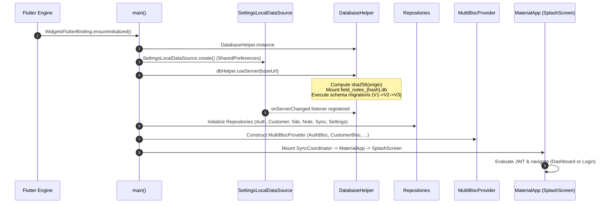
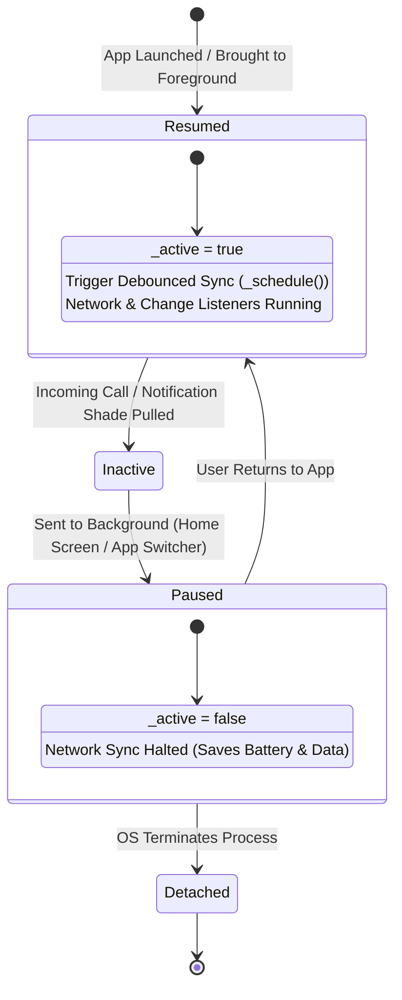
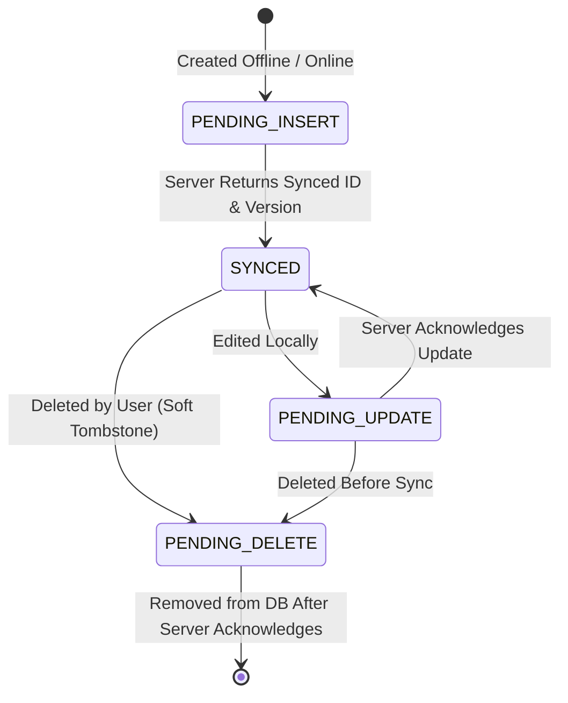
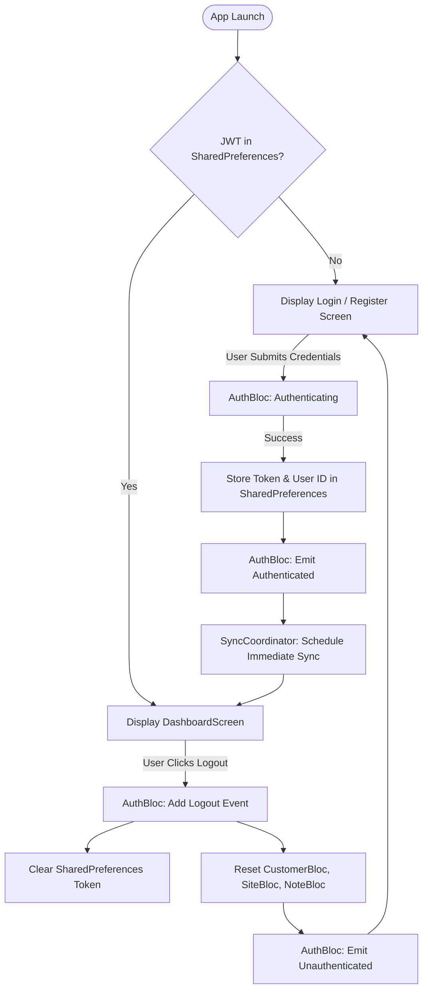

# Client Application Lifecycle & Synchronization Architecture

A comprehensive technical reference for the **Field Notes Client Application** (built with **Flutter 3.x / Dart 3.x**), detailing application bootstrapping, state management with **BLoC**, cross-platform **SQLite persistence**, operating system lifecycle events, and the reactive **SyncCoordinator** engine.

---

## 1. Overview & Architecture Philosophy

The Field Notes client is engineered as a **Local-First, Offline-First** application for Mobile (Android, iOS), Web (WASM/IndexedDB), and Desktop (Windows, Linux, macOS).

```
┌────────────────────────────────────────────────────────────────────────┐
│                        Local-First Architecture                        │
│                                                                        │
│   ┌────────────────────┐                 ┌─────────────────────────┐   │
│   │  Flutter UI / BLoC │                 │  SQLite Embedded Engine │   │
│   │  (Zero Latency)    │ ──────────────> │  (Canonical Local Store)│   │
│   └────────────────────┘  Instant Reads  └─────────────────────────┘   │
│             ▲             & Writes                     │               │
│             │                                          │ Outbox        │
│             │ State                                    │ Mutations     │
│             │ Notifications                            ▼               │
│   ┌────────────────────┐                 ┌─────────────────────────┐   │
│   │  Reactive UI Sync  │ <────────────── │     SyncCoordinator     │   │
│   │  (Refreshed BLoCs) │   Reconciled    │ (Debounced Orchestrator)│   │
│   └────────────────────┘                 └─────────────────────────┘   │
│                                                        │               │
│                                                        │ Push / Pull   │
│                                                        ▼               │
│                                          ┌─────────────────────────┐   │
│                                          │ Spring Boot REST Server │   │
│                                          │ (Central Truth)         │   │
│                                          └─────────────────────────┘   │
└────────────────────────────────────────────────────────────────────────┘
```

### Core Design Tenets:
1. **Zero UI Blocking:** All user actions (creating customers, updating sites, logging field notes with photos) commit immediately to the local embedded SQLite database. The UI never blocks or shows spinners waiting for server network responses.
2. **Deterministic Outbox:** Mutations made while offline are tagged with `sync_status` (`PENDING_INSERT`, `PENDING_UPDATE`, `PENDING_DELETE`) and queued in SQLite.
3. **Reactive Re-synchronization:** The application automatically negotiates synchronization when network connectivity restores, the user resumes the app, or local data changes.
4. **Idempotence & Optimistic Locking:** Entity versions and cryptographic checksums ensure data consistency without lost updates or race conditions.

---

## 2. Bootstrapping & Startup Sequence (`main.dart`)

When the application launches, it executes a strict, asynchronous initialization sequence before mounting widgets:



### Detailed Initialization Steps:
1. **Binding Initialization:** `WidgetsFlutterBinding.ensureInitialized()` establishes communication between Flutter and the host platform OS channels.
2. **Local Settings Initialization:** `SettingsLocalDataSource.create()` loads user preferences from `SharedPreferences` (saved JWT token, user ID, active server URL, default note status).
3. **Database Origin Namespacing:**
   ```dart
   await dbHelper.useServer(settingsDataSource.getBaseUrl());
   settingsDataSource.onServerChanged = dbHelper.useServer;
   ```
   * The database filename is dynamically computed as:
     $$\text{filename} = \text{"field\_notes\_"} + \text{SHA256}(\text{baseUrl}) + \text{".db"}$$
   * Switching backend environments (e.g. from local development `localhost:8080` to production `fieldnotesweb-production.up.railway.app`) switches SQLite files automatically, preventing cross-tenant pollution.
   * If a legacy un-namespaced `field_notes.db` exists, it is automatically migrated into the active server's namespace so offline pending changes are not lost.
4. **Repository Dependency Injection:** Repositories are instantiated with their corresponding data sources (`DatabaseHelper`, `ApiClient`, `SettingsLocalDataSource`).
5. **BLoC Hierarchy Construction:** The widget tree is injected with six core BLoCs via `MultiBlocProvider`:
   * `AuthBloc`: Authentication state and token lifecycle.
   * `CustomerBloc`: Customer entity collection and filters.
   * `SiteBloc`: Site entity collection and parent associations.
   * `FieldNoteBloc`: Notes list, search queries, status filters, and photo payloads.
   * `SyncBloc`: Orchestrates push/pull executions and tracks pending counts.
   * `SettingsBloc`: Manages server endpoints, default statuses, and user preferences.
6. **Root Mount:** `SyncCoordinator` wraps `MaterialApp`, ensuring synchronization listeners are active for the entire application lifespan.

---

## 3. Cross-Platform Embedded Storage Engine (`DatabaseHelper`)

To support Mobile, Web, and Desktop with a unified codebase, `DatabaseHelper` selects the optimal SQLite runtime factory at launch:

```
┌────────────────────────────────────────────────────────────────────────┐
│                  Platform-Specific SQLite Execution                    │
├─────────────────┬───────────────────────────────┬──────────────────────┤
│ Platform Target │ SQLite Engine                 │ Storage Medium       │
├─────────────────┼───────────────────────────────┼──────────────────────┤
│ Web (Browser)   │ sqflite_common_ffi_web (WASM) │ IndexedDB / OPFS     │
│ Windows / Linux │ sqflite_common_ffi            │ AppSupport Directory │
│ Android / iOS   │ sqflite (Native C Driver)     │ Databases Directory  │
└─────────────────┴───────────────────────────────┴──────────────────────┘
```

### 3.1. SQLite Foreign Keys & Pragma Enforcement
On every database connection open:
```dart
onConfigure: (db) => db.execute('PRAGMA foreign_keys = ON'),
```
Cascading deletes (`ON DELETE CASCADE`) are enforced at the database level. Deleting a customer purges linked sites and notes locally, maintaining relational integrity.

### 3.2. Automated Database Migration Pipeline
The database implements schema version tracking:
* **Version 1 (Initial Schema):** Created `customers`, `sites`, `field_notes` with text dates and basic indices.
* **Version 2 (Integrity Migration):**
  - Rebuilt tables with strict foreign key constraints.
  - Added `recovered_records` quarantine table to store any orphan notes or sites whose parents were missing prior to foreign key enforcement.
* **Version 3 (Conflict Tracking & Indices):**
  - Introduced composite primary key `(user_id, entity_type, id)` on `sync_conflicts` table.
  - Added optimized multi-column indices:
    - `idx_customers_user`: `(user_id, is_deleted, sync_status)`
    - `idx_sites_customer`: `(customer_id, is_deleted)`
    - `idx_notes_site_status`: `(site_id, status, is_deleted)`
  - Added `sync_metadata` table for persisting server snapshot ETag digests.

---

## 4. Operating System App Lifecycle States (`WidgetsBindingObserver`)

The mobile client monitors operating system lifecycle transitions by implementing `WidgetsBindingObserver` in `_SyncCoordinatorState`:



### Detailed State Transitions:
1. **`AppLifecycleState.resumed`:**
   * The app is visible, running in the foreground, and accepting user interaction.
   * `SyncCoordinator` sets `_active = true`.
   * Immediately schedules a sync check via `_schedule()`. If any changes occurred on the server while the user was away, the local view updates seamlessly.
2. **`AppLifecycleState.inactive`:**
   * The app is temporarily interrupted (e.g. system permission dialog, phone call overlay).
   * Animations run, but sync operations finish gracefully without initiating aggressive new loops.
3. **`AppLifecycleState.paused`:**
   * The app is hidden in the background (user pressed Home or switched apps).
   * `SyncCoordinator` sets `_active = false`.
   * Scheduled debounces are suppressed, preventing unnecessary CPU wakeups, battery consumption, and mobile data usage.
4. **`AppLifecycleState.detached`:**
   * The Flutter host engine is detaching from the view hierarchy.
   * `dispose()` cancels all active `StreamSubscription`s (connectivity, database changes) and timers (periodic heartbeat, debounce timer).

---

## 5. Reactive SyncCoordinator Engine (`sync_coordinator.dart`)

`SyncCoordinator` is the heart of the synchronization architecture. It unifies four disparate triggers into an intelligent, debounced synchronization queue:

```
┌────────────────────────────────────────────────────────────────────────┐
│                        SyncCoordinator Triggers                        │
├──────────────────────────┬─────────────────────────────────────────────┤
│ 1. App Resumed           │ User opens or returns to the application    │
│ 2. Network Connectivity  │ Device connects to Wi-Fi / Cellular         │
│ 3. Database Mutation     │ Any local INSERT / UPDATE / DELETE stream   │
│ 4. Heartbeat Timer       │ Periodic 60-second background cadence       │
└──────────────────────────┴─────────────────────────────────────────────┘
                                   │
                                   ▼
                    ┌─────────────────────────────┐
                    │ 400ms Debounce Timer        │
                    │ (Batches Rapid UI Mutations)│
                    └─────────────────────────────┘
                                   │
                                   ▼
                    ┌─────────────────────────────┐
                    │ Active Sync Running?        │
                    └─────────────────────────────┘
                       │                       │
                  Yes  ▼                  No   ▼
        ┌──────────────────┐          ┌──────────────────┐
        │ Set _syncAgain   │          │ TriggerSync()    │
        │ = true           │          │ via SyncBloc     │
        └──────────────────┘          └──────────────────┘
```

### 5.1. The 400ms Debounce Mechanism
In field operations, technicians frequently perform rapid sequential actions (e.g., adding a customer, immediately creating two sites, and snapping a photo note).
* Without debouncing, 4 separate HTTP requests would fire immediately, causing race conditions and network contention.
* `_debounce = Timer(const Duration(milliseconds: 400), ...)` collects these rapid mutations into a single cohesive payload.

### 5.2. Concurrency Protection & The `_syncAgain` Re-entrancy Flag
To prevent duplicate sync runs when the network is slow:
* If `SyncBloc.state` is already `SyncInProgress`, the coordinator does not spawn a parallel request.
* Instead, it flags `_syncAgain = true`.
* When the running sync finishes (`SyncSuccess`, `SyncIdle`, or `SyncFailure`), the listener checks:
  ```dart
  if (_syncAgain && (state is SyncIdle || state is SyncFailure)) {
    _syncAgain = false;
    _schedule();
  }
  ```
* This guarantees that mutations made while a sync was in flight are never lost or orphaned.

---

## 6. The Local Outbox Pattern & Sync Protocol

### 6.1. Entity Sync Status Lifecycle
Every table (`customers`, `sites`, `field_notes`) contains a `sync_status` column:



* **`SYNCED`:** Local state matches the server.
* **`PENDING_INSERT`:** Created locally with a client-generated UUIDv4. Pushed during next sync.
* **`PENDING_UPDATE`:** Local edits made; `local_revision` incremented.
* **`PENDING_DELETE`:** Soft delete flag `is_deleted = 1`. Pushed to server to cascade deletions.

### 6.2. Two-Phase Synchronization Protocol (`SyncRepositoryImpl`)

#### Phase 1: Push Local Mutations
1. **Hierarchical Ordering:** Sends parents before children (`customers` $\to$ `sites` $\to$ `notes`).
2. **Payload Chunking:** Batches are capped at 200 records or 4MB to avoid exceeding mobile payload constraints and reverse proxy limits.
3. **Optimistic Locking:** Includes `server_version` as `baseVersion`.
4. **Conflict Handling:** If the server detects a version mismatch, it rejects the edit and returns a conflict notice. The record remains local for inspection in `sync_conflicts`.

#### Phase 2: Pull Server Updates
1. **Conditional ETag Header:** The client passes `If-None-Match: "<cached-sha256>"` from `sync_metadata`.
2. **HTTP 304 Handling:** If the server returns `304 Not Modified`, the client exits immediately, having consumed less than 1KB of network bandwidth.
3. **Atomic SQLite Ingestion:** When updates exist:
   * Opens an atomic SQLite transaction.
   * Reconciles remote records into local tables.
   * Updates `server_version` and resets `sync_status` to `'SYNCED'` for clean records.
   * Saves the new `ETag` to `sync_metadata`.
4. **UI Notification:** Emits `SyncSuccess`, which triggers `LoadCustomers()`, `RefreshSites()`, and `RefreshFieldNotes()` on the active BLoCs.

---

## 7. User Authentication & Session Lifecycle

The authentication lifecycle governs user access and local database state:



### Session Reset on Logout:
When an `Unauthenticated` event occurs:
* `SyncCoordinator` immediately cancels pending debounce timers and clears `_syncAgain`.
* BLoCs receive reset events (`LoadCustomers(reset: true)`, `LoadSites(reset: true)`, `LoadFieldNotes(reset: true)`), clearing in-memory entity lists.
* SQLite records remain safely partitioned by origin/user namespace for offline re-entry.

---

## 8. Hardware & Device Capability Lifecycles

### 8.1. Camera & Image Picker
* **Capture Execution:** Uses `image_picker` to interface with the platform's native camera intent or gallery picker.
* **Compression & Encoding:** Photos are compressed and encoded to base64 strings (`data:image/jpeg;base64,...`) to allow uniform transport across JSON REST APIs and local SQLite TEXT fields.
* **Memory Management (`NotePhoto` widget):** Renders base64 thumbnails with caching and memory-efficient decoding to avoid out-of-memory (OOM) crashes when scrolling large photo lists.

### 8.2. Geolocation / GPS
* **Location Acquisition:** Captures current coordinates (Latitude, Longitude) when a field note is created.
* **Fallback Behavior:** If GPS permissions are denied or unavailable indoors, the location field gracefully accepts manual text input or remains empty without blocking note creation.
