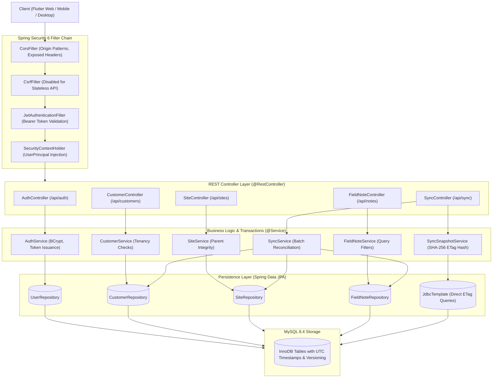
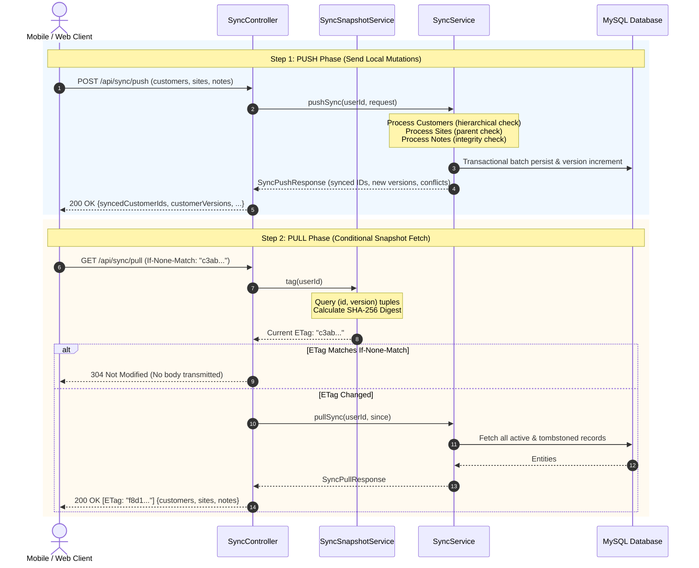

# Backend Architecture & Technical Specification

A comprehensive technical reference for the **Field Notes REST Backend**, built with **Spring Boot 3 (Java 21 LTS)**, **Spring Security 6**, **Spring Data JPA / Hibernate**, and **MySQL 8.x**.

---

## 1. Executive Summary & Technology Stack

The Field Notes backend is an enterprise-grade, stateless REST microservice designed to serve both web applications (Vercel-hosted SPA) and native mobile applications (Flutter on Android/iOS/Desktop). It handles user authentication, CRUD operations, and an offline-first synchronization engine with optimistic concurrency control and cryptographic change tracking.

```
┌────────────────────────────────────────────────────────────────────────┐
│                        Backend Technology Stack                        │
├──────────────────────┬─────────────────────────────────────────────────┤
│ Runtime Engine       │ Java 21 LTS (Eclipse Temurin)                   │
│ Application Framework│ Spring Boot 3.2.x                               │
│ Security & Auth      │ Spring Security 6.x + Stateless JWT             │
│ Persistence & ORM    │ Spring Data JPA + Hibernate 6.x + HikariCP      │
│ Database Engine      │ MySQL 8.4 InnoDB                                │
│ Schema Migrations    │ Flyway Core (Automated DDL execution on boot)   │
│ Validation           │ Jakarta Validation API / Hibernate Validator    │
│ Build & Tooling      │ Apache Maven 3.9+                               │
│ Containerization     │ Multi-Stage Docker (Eclipse Temurin 21 JRE)     │
│ Cloud Hosting        │ Railway Cloud Platform                          │
└──────────────────────┴─────────────────────────────────────────────────┘
```

---

## 2. High-Level Architectural Pattern

The backend strictly adheres to a **Layered Hexagonal / Clean Architecture** pattern. Incoming HTTP requests flow through a security filter chain before being routed to REST controllers, processed by transactional service components, and persisted via Spring Data repositories.



---

## 3. Package & Source Code Organization

The backend source code (`backend/src/main/java/com/fieldnotes/`) is structured into dedicated, decoupled packages:

```
com.fieldnotes
│
├── FieldNotesApplication.java          # Spring Boot main bootstrap class
│
├── controller                          # Web API Endpoints (@RestController)
│   ├── AuthController.java             # Register & Login endpoints
│   ├── CustomerController.java         # Customer CRUD management
│   ├── SiteController.java             # Site CRUD management
│   ├── FieldNoteController.java        # Field Note CRUD & filter management
│   └── SyncController.java             # Push/Pull synchronization & ETag validation
│
├── dto                                 # Data Transfer Objects & Validation rules
│   ├── auth
│   │   ├── LoginRequest.java           # Email/password authentication payload
│   │   ├── RegisterRequest.java        # Account registration payload
│   │   └── AuthResponse.java           # JWT bearer token & user metadata response
│   ├── customer
│   │   ├── CustomerRequest.java        # Name & contact validation schema
│   │   └── CustomerDto.java            # Client-facing customer model
│   ├── site
│   │   ├── SiteRequest.java            # SiteName, address, customerId validation
│   │   └── SiteDto.java                # Client-facing site model
│   ├── note
│   │   ├── FieldNoteRequest.java       # Title, location, photo, status schema
│   │   └── FieldNoteDto.java           # Client-facing field note model
│   └── sync
│       ├── SyncPushRequest.java        # Batch upload of mutated local records
│       ├── SyncPushResponse.java       # Acknowledged IDs, versions & conflicts
│       └── SyncPullResponse.java       # Incremental/Full snapshot of remote entities
│
├── model                               # JPA Hibernate Entities
│   ├── User.java                       # System account entity
│   ├── Customer.java                   # Customer record owned by User
│   ├── Site.java                       # Site record belonging to Customer
│   └── FieldNote.java                  # Field Note record belonging to Site
│
├── repository                          # Spring Data JPA Repository Interfaces
│   ├── UserRepository.java             # Query methods by username and email
│   ├── CustomerRepository.java         # Tenant-filtered customer queries
│   ├── SiteRepository.java             # Tenant & parent filtered site queries
│   └── FieldNoteRepository.java        # Filtered queries with search & status
│
├── security                            # Spring Security 6 & JWT Infrastructure
│   ├── CustomUserDetailsService.java   # UserDetailsService bridge for Spring Auth
│   ├── JwtAuthenticationFilter.java    # Per-request bearer token extractor
│   ├── JwtTokenProvider.java           # HMAC-SHA256 signature generator & parser
│   ├── SecurityConfig.java             # WebSecurity, CORS filter & permit rules
│   └── UserPrincipal.java              # Authenticated user representation
│
├── service                             # Business Logic & Transaction Demarcation
│   ├── AuthService.java                # Registration, BCrypt matching, JWT minting
│   ├── CustomerService.java            # Customer validation & tenancy enforcement
│   ├── SiteService.java                # Site hierarchy & parent existence checks
│   ├── FieldNoteService.java           # Note filtering, search & status updates
│   ├── SyncService.java                # Batch push reconciliation & conflict logic
│   └── SyncSnapshotService.java        # Fast SHA-256 ETag digest generator
│
└── exception                           # Exception Handling & RFC 7807 Error Mappings
    ├── BadRequestException.java        # HTTP 400 Bad Request
    ├── ConflictException.java          # HTTP 409 Conflict
    ├── ResourceNotFoundException.java  # HTTP 404 Not Found
    ├── UnauthorizedException.java      # HTTP 401 Unauthorized
    └── GlobalExceptionHandler.java     # @ControllerAdvice centralized handler
```

---

## 4. Security, Authentication & CORS Engine

### 4.1. Stateless JWT Security Lifecycle

Authentication is completely stateless; no HTTP sessions (`JSESSIONID`) are maintained on the server.

1. **Client Request:** The client sends an HTTP request with an `Authorization` header:
   ```http
   Authorization: Bearer <jwt-token>
   ```
2. **Filter Interception (`JwtAuthenticationFilter`):**
   * Checks for `Authorization` header starting with `Bearer `.
   * Extracts raw token and calls `JwtTokenProvider.validateToken(token)`.
   * Verifies the cryptographic signature against `${JWT_SECRET}` and verifies that the expiration timestamp has not elapsed.
   * Resolves the `userId` claim.
   * Loads `UserPrincipal` via `CustomUserDetailsService` and constructs a `UsernamePasswordAuthenticationToken`.
   * Sets the authenticated context into `SecurityContextHolder.getContext().setAuthentication(auth)`.
3. **Controller Injection:**
   * Handlers access the current authenticated user via `@AuthenticationPrincipal UserPrincipal currentUser`.

### 4.2. CORS Configuration (`SecurityConfig.java`)

To permit seamless cross-origin interactions across web and mobile clients:
* **Allowed Origin Patterns:** Set to `*` to allow Vercel dynamic preview URLs (`https://*-shongket.vercel.app`), Vercel production domains (`https://fieldnotes-bay.vercel.app`), and local development environments (`http://localhost:7357`, `http://localhost:3000`).
* **Allowed Methods:** `GET`, `POST`, `PUT`, `DELETE`, `OPTIONS`, `PATCH`.
* **Allowed Headers:** `*` (All request headers permitted).
* **Exposed Headers:** `ETag`, `Authorization` (Crucial for client-side conditional caching and token retrieval).
* **Credentials:** Disabled (`setAllowCredentials(false)`), allowing permissive wildcard origin patterns without browser security rejections.

```java
@Bean
public CorsConfigurationSource corsConfigurationSource() {
    CorsConfiguration configuration = new CorsConfiguration();
    configuration.setAllowedOriginPatterns(List.of("*"));
    configuration.setAllowedMethods(List.of("GET", "POST", "PUT", "DELETE", "OPTIONS", "PATCH"));
    configuration.setAllowedHeaders(List.of("*"));
    configuration.setAllowCredentials(false);
    configuration.setExposedHeaders(List.of("ETag", "Authorization"));
    UrlBasedCorsConfigurationSource source = new UrlBasedCorsConfigurationSource();
    source.registerCorsConfiguration("/**", configuration);
    return source;
}
```

---

## 5. Comprehensive REST API Reference

All API requests (except `/api/auth/**`) require the HTTP header:
`Authorization: Bearer <token>`

### 5.1. Authentication (`/api/auth`)

#### `POST /api/auth/register`
Creates a new user account with BCrypt password hashing.
* **Request Body:**
  ```json
  {
    "username": "monour",
    "email": "monour@example.com",
    "password": "StrongPassword123!"
  }
  ```
* **Response (HTTP 201 Created):**
  ```json
  {
    "token": "eyJhbGciOiJIUzI1NiJ9...",
    "type": "Bearer",
    "id": 1,
    "username": "monour",
    "email": "monour@example.com"
  }
  ```

#### `POST /api/auth/login`
Validates credentials and issues a JWT token.
* **Request Body:**
  ```json
  {
    "username": "monour",
    "password": "StrongPassword123!"
  }
  ```
* **Response (HTTP 200 OK):** Identical to registration response.

---

### 5.2. Customers (`/api/customers`)

| Method | Endpoint | Description | Status Code |
| :--- | :--- | :--- | :--- |
| `POST` | `/api/customers` | Create a new customer | `201 Created` |
| `GET` | `/api/customers` | List all active customers for user | `200 OK` |
| `GET` | `/api/customers/{id}` | Get customer by ID | `200 OK` |
| `PUT` | `/api/customers/{id}` | Update customer name/contact | `200 OK` |
| `DELETE` | `/api/customers/{id}` | Soft delete customer & cascade children | `204 No Content` |

**Sample Customer JSON:**
```json
{
  "id": "c1f7a180-2a3b-4c5d-8e9f-0123456789ab",
  "name": "Apex Manufacturing Ltd.",
  "contactInformation": "manager@apex.com | +880-1700-000000",
  "createdAt": 1728864000000,
  "updatedAt": 1728864000000,
  "version": 1,
  "deleted": false
}
```

---

### 5.3. Sites (`/api/sites`)

| Method | Endpoint | Query Params | Description | Status Code |
| :--- | :--- | :--- | :--- | :--- |
| `POST` | `/api/sites` | - | Create a new site under customer | `201 Created` |
| `GET` | `/api/sites` | `customerId` (optional) | List sites (optionally filtered) | `200 OK` |
| `GET` | `/api/sites/{id}` | - | Get site by ID | `200 OK` |
| `PUT` | `/api/sites/{id}` | - | Update site name/address | `200 OK` |
| `DELETE` | `/api/sites/{id}` | - | Soft delete site & cascade notes | `204 No Content` |

**Sample Site JSON:**
```json
{
  "id": "s8e9f012-3456-789a-bcde-f0123456789a",
  "customerId": "c1f7a180-2a3b-4c5d-8e9f-0123456789ab",
  "siteName": "Substation Alpha",
  "address": "Plot 42, Export Processing Zone, Dhaka",
  "createdAt": 1728864100000,
  "updatedAt": 1728864100000,
  "version": 1,
  "deleted": false
}
```

---

### 5.4. Field Notes (`/api/notes`)

| Method | Endpoint | Query Params | Description | Status Code |
| :--- | :--- | :--- | :--- | :--- |
| `POST` | `/api/notes` | - | Create new field note | `201 Created` |
| `GET` | `/api/notes` | `query`, `siteId`, `status` | Search & filter field notes | `200 OK` |
| `GET` | `/api/notes/{id}` | - | Get note details | `200 OK` |
| `PUT` | `/api/notes/{id}` | - | Update note content/status/photo | `200 OK` |
| `DELETE` | `/api/notes/{id}` | - | Soft delete field note | `204 No Content` |

**Sample Field Note JSON:**
```json
{
  "id": "n9a8b7c6-d5e4-f3a2-b1c0-fedcba987654",
  "siteId": "s8e9f012-3456-789a-bcde-f0123456789a",
  "title": "Main Transformer Thermal Anomaly",
  "description": "High temperature alert on Phase B winding. Requires coolant top-up.",
  "location": "23.8103° N, 90.4125° E",
  "dateTime": 1728864200000,
  "status": "In Progress",
  "photo": "data:image/jpeg;base64,/9j/4AAQSkZJRgABAQAAAQ...",
  "createdAt": 1728864200000,
  "updatedAt": 1728864200000,
  "version": 1,
  "deleted": false
}
```

---

## 6. Offline-First Synchronization Engine

The synchronization engine is the core differentiator of the Field Notes backend. It coordinates bidirectional sync between distributed local SQLite clients and the central MySQL database.



### 6.1. Push Protocol & Conflict Resolution (`/api/sync/push`)

* **Hierarchical Dependency Ordering:**
  The server processes entities in strictly top-down order:
  1. `customers`
  2. `sites`
  3. `notes`
  This prevents foreign key constraint violations during insert.
* **Optimistic Version Checking:**
  Each incoming record contains a `baseVersion`.
  - **Insert Case (`baseVersion == null`):** If the record does not exist on the server, create it with `version = 1`.
  - **Clean Update Case (`baseVersion == server.version`):** Apply field updates, increment `version`, update `updated_at`.
  - **Stale Update Case (`baseVersion != server.version`):**
    - *Identical State Check:* If the incoming payload values exactly match the server's existing values, consider it a redundant sync: acknowledge the record and return the current server version.
    - *True Conflict:* If values differ, do NOT overwrite. Append an error string to `conflicts` (e.g., `"Note <id>: newer server version"`). The client preserves the unmerged item for user review.
* **Cascading Soft Deletions:**
  When a customer is flagged as `isDeleted = true`, the backend automatically cascades the deletion:
  - All linked sites are flagged `deleted = true`.
  - All linked notes are flagged `deleted = true`.
  - `updated_at` timestamps are updated so that downstream pull synchronization delivers tombstones to all other connected client devices.

### 6.2. Snapshot Hashing & Bandwidth Optimization (`SyncSnapshotService.java`)

To prevent mobile and web clients from downloading megabytes of base64 photos on every periodic sync loop, the backend implements **cryptographic ETag snapshot tagging**:

```java
@Transactional(readOnly=true)
public String tag(Long userId) {
    var digest = MessageDigest.getInstance("SHA-256");
    String[] queries = {
        "select id, version from customers where user_id=? order by id",
        "select s.id,s.version from sites s join customers c on c.id=s.customer_id where c.user_id=? order by s.id",
        "select n.id,n.version from field_notes n join sites s on s.id=n.site_id join customers c on c.id=s.customer_id where c.user_id=? order by n.id"
    };
    for (int i = 0; i < queries.length; i++) {
        digest.update((byte) i);
        jdbc.query(queries[i], row -> {
            digest.update((row.getString(1) + ":" + row.getLong(2) + ";").getBytes(StandardCharsets.UTF_8));
        }, userId);
    }
    return "\"" + HexFormat.of().formatHex(digest.digest()) + "\"";
}
```

* **Zero Photo Transfer:** The snapshot query reads *only* primary keys (`id`) and optimistic lock integers (`version`).
* **Instant 304 Response:** If neither customers, sites, nor notes have changed, the computed SHA-256 matches the client's `If-None-Match` header. The server responds with `HTTP 304 Not Modified` and zero payload bytes.

---

## 7. Global Exception Handling & Error Formats

Centralized exception mapping is managed by `GlobalExceptionHandler` using `@RestControllerAdvice`:

```json
{
  "timestamp": 1728864300000,
  "status": 404,
  "error": "Not Found",
  "message": "Customer not found with id: c1f7a180-2a3b...",
  "path": "/api/customers/c1f7a180-2a3b..."
}
```

### Handled Exceptions
* `ResourceNotFoundException` $\longrightarrow$ `HTTP 404 Not Found`
* `BadRequestException` $\longrightarrow$ `HTTP 400 Bad Request`
* `ConflictException` $\longrightarrow$ `HTTP 409 Conflict` (e.g., username or email already registered)
* `UnauthorizedException` $\longrightarrow$ `HTTP 401 Unauthorized`
* `MethodArgumentNotValidException` $\longrightarrow$ `HTTP 400 Bad Request` (collects field-specific validation errors)
* `Exception` (catch-all) $\longrightarrow$ `HTTP 500 Internal Server Error`

---

## 8. Configuration & Environment Variables

All configuration is externalized via `backend/src/main/resources/application.yml` and overridable via standard system environment variables:

```yaml
server:
  port: ${SERVER_PORT:8080}
  tomcat:
    max-http-form-post-size: 20MB

spring:
  application:
    name: field-notes-backend
  datasource:
    url: ${DB_URL:jdbc:mysql://localhost:3306/field_notes_db?serverTimezone=UTC}
    username: ${DB_USERNAME:field_notes}
    password: ${DB_PASSWORD}
  jpa:
    open-in-view: false
    properties:
      hibernate.jdbc.time_zone: UTC
    hibernate:
      ddl-auto: validate
  flyway:
    enabled: true
    baseline-on-migrate: false

app:
  jwt:
    secret: ${JWT_SECRET}
    expiration-ms: ${JWT_EXPIRATION_MS:86400000}
  cors-origins: ${CORS_ORIGINS:http://localhost:7357,http://127.0.0.1:7357,https://*.vercel.app}
```

### Environment Variables Glossary
* `SERVER_PORT`: HTTP listener port (defaults to `8080` or provided dynamically by Railway).
* `DB_URL`: JDBC connection string pointing to MySQL 8.x server.
* `DB_USERNAME`: Database user.
* `DB_PASSWORD`: Database user password.
* `JWT_SECRET`: Cryptographically strong 256-bit secret key used for HMAC-SHA256 signature verification.
* `JWT_EXPIRATION_MS`: Token lifetime in milliseconds (default: `86400000` = 24 hours).
* `CORS_ORIGINS`: Comma-separated list of permitted origin patterns.

---

## 9. Containerization & Production Deployment

The backend is built using a multi-stage Dockerfile (`backend/Dockerfile`):

```dockerfile
# Stage 1: Build the application using Maven and Java 21
FROM maven:3.9.6-eclipse-temurin-21 AS build
WORKDIR /app
COPY pom.xml .
RUN mvn dependency:go-offline -B
COPY src ./src
RUN mvn clean package -DskipTests

# Stage 2: Minimal runtime image
FROM eclipse-temurin:21-jre-jammy
WORKDIR /app
COPY --from=build /app/target/field-notes-backend-*.jar app.jar
EXPOSE 8080
ENV SERVER_PORT=8080
ENTRYPOINT ["java", "-jar", "app.jar"]
```

### Production Runtime Characteristics
1. **Container Layering:** Dependencies are pre-cached in layer 1 (`dependency:go-offline`), allowing sub-minute rebuilds when only application code changes.
2. **Minimal Footprint:** The final production container uses `eclipse-temurin:21-jre-jammy`, eliminating Maven, compilers, and extraneous build tools to reduce attack surface and memory footprint.
3. **Automated Flyway Bootstrapping:** When the container starts on Railway, Spring Boot executes Flyway migrations (`V1`, `V2`, `V3`) before opening the HTTP port, ensuring schema compatibility before processing incoming client requests.
