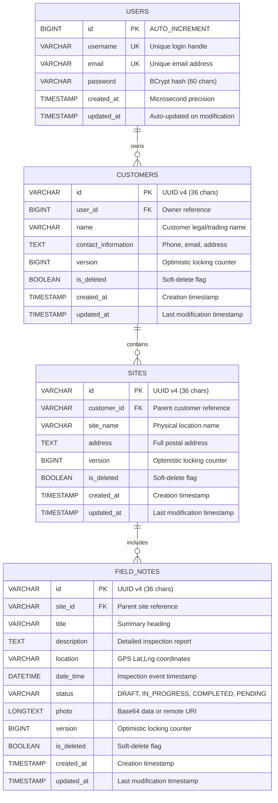

# Database Schema and Railway Infrastructure Guide

A comprehensive, production-grade technical specification of the Field Notes database architecture, relational schema, Flyway migrations, and Railway cloud deployment topology.

---

## 1. High-Level Architecture & Topology

The Field Notes platform employs a relational, multi-tenant persistence architecture backed by **MySQL 8.x** running on **Railway Cloud Platform**. The database is designed for strict referential integrity, optimistic concurrency control, and seamless offline-first synchronization.

```
┌────────────────────────────────────────────────────────────────────────┐
│                        Railway Cloud Infrastructure                    │
│                                                                        │
│   ┌────────────────────────────────┐   Private Docker Network          │
│   │   Spring Boot 3 REST Backend   │ ───────────────────────┐          │
│   │   (Java 21 Virtual Machine)    │                        │          │
│   └────────────────────────────────┘                        ▼          │
│                   │                         ┌──────────────────────┐   │
│                   │ HikariCP Pool           │   MySQL 8.4 Server   │   │
│                   │ Port 3306               │   (InnoDB Engine)    │   │
│                   └───────────────────────> └──────────────────────┘   │
│                                                             │          │
│                                                             ▼          │
│                                                     ┌──────────────┐   │
│                                                     │ mysql-volume │   │
│                                                     │ (Persistent) │   │
│                                                     └──────────────┘   │
└────────────────────────────────────────────────────────────────────────┘
```

### Connection Specification
* **Engine:** MySQL 8.4 (InnoDB default)
* **Character Set:** `utf8mb4`
* **Collation:** `utf8mb4_unicode_ci` (full multilingual and emoji support)
* **Timezone:** Coordinated Universal Time (`UTC`)
* **JDBC URL Format:**
  ```properties
  jdbc:mysql://${{MySQL.MYSQLHOST}}:${{MySQL.MYSQLPORT}}/${{MySQL.MYSQLDATABASE}}?serverTimezone=UTC&useSSL=true&allowPublicKeyRetrieval=true
  ```

---

## 2. Entity-Relationship Model (ERD)

The database schema enforces a strict four-tier hierarchical ownership domain:
**User $\longrightarrow$ Customer $\longrightarrow$ Site $\longrightarrow$ Field Note**



---

## 3. Detailed Table Schema Definitions

### 3.1. `users` Table
Stores authenticated field inspector accounts. User accounts are created online and authenticated using signed JWT tokens.

| Column | Type | Nullable | Default | Description |
| :--- | :--- | :---: | :---: | :--- |
| `id` | `BIGINT` | **NO** | `AUTO_INCREMENT` | Primary key |
| `username` | `VARCHAR(100)` | **NO** | - | Unique login identifier (case-insensitive collation) |
| `email` | `VARCHAR(150)` | **NO** | - | Unique email address |
| `password` | `VARCHAR(255)` | **NO** | - | Secure BCrypt salted password hash |
| `created_at` | `TIMESTAMP(6)` | **NO** | `CURRENT_TIMESTAMP(6)` | Audit creation timestamp |
| `updated_at` | `TIMESTAMP(6)` | **NO** | `CURRENT_TIMESTAMP(6)` | Auto-updating timestamp |

* **Constraints:** `PRIMARY KEY (id)`, `UNIQUE KEY (username)`, `UNIQUE KEY (email)`.

---

### 3.2. `customers` Table
Represents clients or businesses for whom inspections are performed. All customer records are strictly scoped to the creating user.

| Column | Type | Nullable | Default | Description |
| :--- | :--- | :---: | :---: | :--- |
| `id` | `VARCHAR(36)` | **NO** | - | Client-generated or server-generated UUID v4 |
| `user_id` | `BIGINT` | **NO** | - | Foreign key to `users(id)` |
| `name` | `VARCHAR(255)` | **NO** | - | Customer name |
| `contact_information`| `TEXT` | YES | `NULL` | Freeform contact metadata |
| `version` | `BIGINT` | **NO** | `0` | Monotonic version for optimistic locking |
| `is_deleted` | `BOOLEAN` | **NO** | `FALSE` | Tombstone indicator for soft deletion |
| `created_at` | `TIMESTAMP(6)` | **NO** | `CURRENT_TIMESTAMP(6)` | Microsecond creation timestamp |
| `updated_at` | `TIMESTAMP(6)` | **NO** | `CURRENT_TIMESTAMP(6)` | Auto-updating modification timestamp |

* **Foreign Keys:** `CONSTRAINT fk_customer_user FOREIGN KEY (user_id) REFERENCES users(id) ON DELETE CASCADE`.
* **Indices:**
  * `idx_customer_user (user_id)`
  * `idx_customer_updated (updated_at)`
  * `idx_customer_user_updated (user_id, updated_at)` (Composite index for rapid sync queries).

---

### 3.3. `sites` Table
Represents physical locations (facilities, factories, plots) affiliated with a specific customer.

| Column | Type | Nullable | Default | Description |
| :--- | :--- | :---: | :---: | :--- |
| `id` | `VARCHAR(36)` | **NO** | - | UUID v4 string |
| `customer_id` | `VARCHAR(36)` | **NO** | - | Foreign key to `customers(id)` |
| `site_name` | `VARCHAR(255)` | **NO** | - | Name of the site |
| `address` | `TEXT` | YES | `NULL` | Physical/postal address |
| `version` | `BIGINT` | **NO** | `0` | Monotonic version counter |
| `is_deleted` | `BOOLEAN` | **NO** | `FALSE` | Soft delete flag |
| `created_at` | `TIMESTAMP(6)` | **NO** | `CURRENT_TIMESTAMP(6)` | Creation timestamp |
| `updated_at` | `TIMESTAMP(6)` | **NO** | `CURRENT_TIMESTAMP(6)` | Modification timestamp |

* **Foreign Keys:** `CONSTRAINT fk_site_customer FOREIGN KEY (customer_id) REFERENCES customers(id) ON DELETE CASCADE`.
* **Indices:** `idx_site_customer (customer_id)`, `idx_site_updated (updated_at)`.

---

### 3.4. `field_notes` Table
Core inspection records including condition descriptions, geolocation coordinates, inspection timestamps, status, and photos.

| Column | Type | Nullable | Default | Description |
| :--- | :--- | :---: | :---: | :--- |
| `id` | `VARCHAR(36)` | **NO** | - | UUID v4 primary identifier |
| `site_id` | `VARCHAR(36)` | **NO** | - | Foreign key to `sites(id)` |
| `title` | `VARCHAR(255)` | **NO** | - | Brief title/heading of the note |
| `description` | `TEXT` | YES | `NULL` | Detailed observation log |
| `location` | `VARCHAR(255)` | YES | `NULL` | Formatted coordinates: `"lat,lng"` |
| `date_time` | `DATETIME(6)` | YES | `NULL` | Observation timestamp (supports years 1000–9999) |
| `status` | `VARCHAR(50)` | **NO** | - | Inspection status enum |
| `photo` | `LONGTEXT` | YES | `NULL` | Base64-encoded image string or remote URI (up to 4GB) |
| `version` | `BIGINT` | **NO** | `0` | Optimistic concurrency revision |
| `is_deleted` | `BOOLEAN` | **NO** | `FALSE` | Soft-deletion flag |
| `created_at` | `TIMESTAMP(6)` | **NO** | `CURRENT_TIMESTAMP(6)` | Record creation timestamp |
| `updated_at` | `TIMESTAMP(6)` | **NO** | `CURRENT_TIMESTAMP(6)` | Record modification timestamp |

* **Status Values:** `DRAFT`, `IN_PROGRESS`, `COMPLETED`, `PENDING`.
* **Foreign Keys:** `CONSTRAINT fk_note_site FOREIGN KEY (site_id) REFERENCES sites(id) ON DELETE CASCADE`.
* **Indices:** `idx_note_site (site_id)`, `idx_note_status (status)`, `idx_note_updated (updated_at)`.

---

## 4. Flyway Database Migrations

Database schema evolution is managed deterministically via **Flyway**. Automated baselining is intentionally disabled so schema discrepancies in production trigger immediate validation alerts rather than silent drift.

### Migration History Table: `flyway_schema_history`
Flyway tracks applied versions with SHA-256 checksums to ensure identical database state across development, testing, and production.

```
backend/src/main/resources/db/migration/
├── V1__init_schema.sql
├── V2__versioned_records.sql
└── V3__inspection_datetime_range.sql
```

### Migration Version Highlights
1. **`V1__init_schema.sql`**:
   - Provisions tables: `users`, `customers`, `sites`, `field_notes`.
   - Defines foreign keys with `ON DELETE CASCADE`.
   - Establishes microsecond `TIMESTAMP(6)` audit columns.
2. **`V2__versioned_records.sql`**:
   - Adds `version BIGINT NOT NULL DEFAULT 0` to `customers`, `sites`, and `field_notes` to enable JPA `@Version` optimistic locking.
   - Adds composite index `idx_customer_user_updated ON customers(user_id, updated_at)`.
3. **`V3__inspection_datetime_range.sql`**:
   - Converts `field_notes.date_time` from `TIMESTAMP(6)` to `DATETIME(6)`.
   - **Rationale:** Standard Unix `TIMESTAMP` overflows in January 2038 (the Year 2038 problem) and cannot represent dates prior to 1970. Historical equipment inspections or future scheduled reviews require the expanded range ($1000\text{--}9999$).

---

## 5. Concurrency & Cascading Deletion Strategy

### 5.1. Soft Deletion & Cascading Tombstones
To prevent orphaned data while retaining audit integrity for offline synchronization:
* When a customer is marked `is_deleted = TRUE`, the backend triggers a cascade that marks all child `sites` and grandchild `field_notes` as `is_deleted = TRUE` and updates their `updated_at` timestamps.
* This ensures that when an offline client pulls changes, it receives deletion tombstones for the entire subtree, removing them cleanly from the local mobile SQLite database.

### 5.2. Optimistic Concurrency Control (OCC)
* Every mutation request to the backend includes a `baseVersion` (or `version`).
* If a concurrent client modified the record in the interim, the record's `version` will not match `baseVersion`.
* The server responds with `409 Conflict`, preserving data integrity and avoiding silent overwrites ("last-write-wins" hazards).

---

## 6. Railway Cloud Operations & Deployment Guide

### 6.1. Railway Infrastructure Components
* **Service 1:** `MySQL 8.4` managed database instance attached to a dedicated persistent Docker volume (`mysql-volume`).
* **Service 2:** `Field_Notes_web` Spring Boot backend compiled from source via multi-stage Docker build.

### 6.2. Environment Variables Configuration
In Railway Project $\rightarrow$ `Field_Notes_web` $\rightarrow$ **Variables**:

```properties
# Database Connectivity
DB_URL=jdbc:mysql://${{MySQL.MYSQLHOST}}:${{MySQL.MYSQLPORT}}/${{MySQL.MYSQLDATABASE}}?serverTimezone=UTC&useSSL=true&allowPublicKeyRetrieval=true
DB_USERNAME=${{MySQL.MYSQLUSER}}
DB_PASSWORD=${{MySQL.MYSQLPASSWORD}}

# Security & CORS
JWT_SECRET=super-secret-jwt-key-minimum-32-characters-long
CORS_ORIGINS=*

# Server
SERVER_PORT=8080
```

### 6.3. Persistent Storage & Backups
* All MySQL data files reside on Railway's encrypted block storage volume mounted at `/var/lib/mysql`.
* Automated daily backups are maintained in Railway under the **Backups** tab, providing point-in-time recovery without service disruption.

### 6.4. Health Checks and Maintenance
* **Liveness:** Railway monitors HTTP responses from the backend application.
* **Database Ping:** Spring Boot validates database connections on startup using HikariCP's `connectionTestQuery` and Flyway migration runner. If MySQL is unreachable, the backend container restarts automatically until the database is ready.
